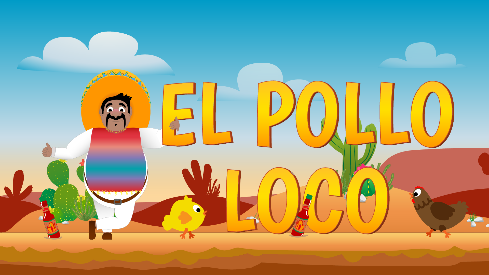
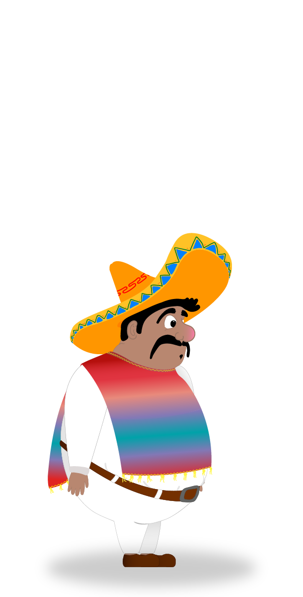
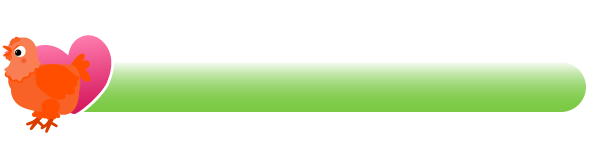
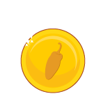
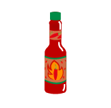
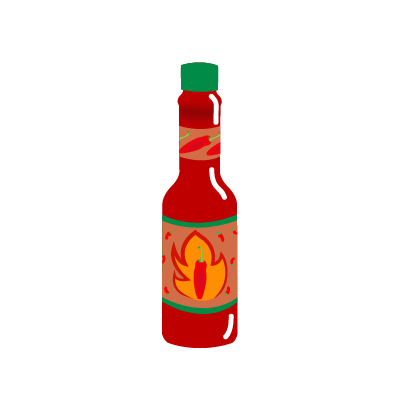
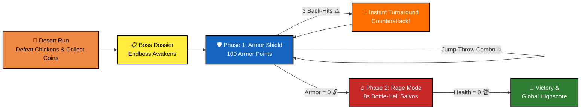
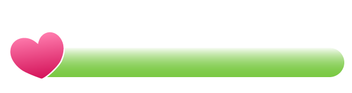

<div align="center">



# 🌵🌶️ EL POLLO LOCO – TACTICAL EDITION 🐔🔥

**Survive the scorching Mexican desert, master the live Salsa Economy, and bring down the ultimate feathered nightmare!**

<p>
  
  
  
  
  
  
  
</p>

</div>

---

## 🎯 What Makes It Tactical?

<table>
  <tr>
    <td align="center" width="25%">
      <br />
      <strong>🤠 Play as Pepe</strong><br />
      <sub>Fluid jumping, stomping, and mid-air Jump-Throw combos across a dynamic desert stage.</sub>
    </td>
    <td align="center" width="25%">
      <br /><br />
      <strong>🛡️ 100-Point Boss Armor</strong><br />
      <sub>Break the Endboss's armor shield first—and watch out for 3-hit backstab counters!</sub>
    </td>
    <td align="center" width="25%">
      
      <br />
      <strong>🪙 Live Coin Economy</strong><br />
      <sub>Out of ammo mid-fight? Press <kbd>B</kbd> to trade 2 Coins for a fresh Salsa Bottle!</sub>
    </td>
    <td align="center" width="25%">
      <br />
      <strong>🔥 Rage Mode Salvos</strong><br />
      <sub>Once the armor shatters, dodge escalating 8-second bottle-hell barrages to win.</sub>
    </td>
  </tr>
</table>

---

## ⚔️ Boss Battle Flow



---

## 🪙 Live Coin-to-Ammo Converter

<div align="center">


&nbsp;&nbsp; ➔ &nbsp;&nbsp; <kbd>B</kbd> &nbsp;&nbsp; ➔ &nbsp;&nbsp;


*Never get caught empty-handed—convert collected desert coins into fiery salsa bottles right in the heat of battle!*

</div>

---

## 🎮 Controls

<table>
  <tr>
    <th width="50%">⌨️ Desktop Keyboard</th>
    <th width="50%">📱 Mobile & Tablet Touch HUD</th>
  </tr>
  <tr>
    <td valign="top">
      <table>
        <tr><td><kbd>A</kbd> <kbd>D</kbd> / <kbd>←</kbd> <kbd>→</kbd></td><td>🏃 Move Pepe</td></tr>
        <tr><td><kbd>Space</kbd></td><td>🦘 Jump</td></tr>
        <tr><td><kbd>Enter</kbd></td><td>🍾 Throw Salsa Bottle</td></tr>
        <tr><td><kbd>Space</kbd> + <kbd>Enter</kbd></td><td>💥 <strong>Jump-Throw Combo</strong> (Crit!)</td></tr>
        <tr><td><kbd>B</kbd></td><td>🪙 Buy Bottle (2 Coins)</td></tr>
        <tr><td><kbd>Tab</kbd></td><td>⏸️ Pause / Back</td></tr>
      </table>
    </td>
    <td valign="top">
      <table>
        <tr><td>🔴 <code>◀ ● ▶</code> Slider</td><td>🏃 Slide to Move</td></tr>
        <tr><td>🟢 <code>Space</code> Button</td><td>🦘 Jump</td></tr>
        <tr><td>🔵 <code>Enter</code> Button</td><td>🍾 Throw Salsa Bottle</td></tr>
        <tr><td>🟢 + 🔵 Multi-Touch</td><td>💥 <strong>Jump-Throw Combo</strong> (Crit!)</td></tr>
        <tr><td>🟡 <code>B</code> Button</td><td>🪙 Buy Bottle (2 Coins)</td></tr>
        <tr><td>⚪ <code>Tab</code> Button</td><td>⏸️ Pause / Back</td></tr>
      </table>
    </td>
  </tr>
</table>

> 💡 **Pro Tip:** On smartphones and tablets, enable **Fullscreen Mode** inside **Settings** for an edge-to-edge arcade experience!

---

## ✨ Key Highlights

- 🎵 **100% Synthesized Web Audio:** Procedural SFX and adaptive music tracks (*Menu*, *Desert Level*, *Boss Battle*) with persistent mute settings.
- 🌍 **Global Highscore Leaderboard:** Powered by **Firebase Realtime Database**, including automatic offline fallback so no victory score is ever lost.
- 📱 **Adaptive Multi-Screen Support:** Seamlessly scales across ultrawide desktops, tablets, smartphones, and compact landscape viewports—complete with a portrait orientation lock screen.
- ♿ **Accessible by Design (WCAG 2.1 AA):** Full keyboard navigation, skip link, high-contrast focus outlines, ARIA live regions, `prefers-reduced-motion` support, minimum `16px` typography, and `44×44px` touch targets.

---

## 🚀 Getting Started

1. **Clone the repository**
   ```bash
   git clone [https://github.com/](https://github.com/)<your-username>/el-pollo-loco.git
   cd el-pollo-loco
   ```

2. **Launch a local server** *(VS Code Live Server or `npx`)*
   ```bash
   npx serve .
   ```

3. **Play!**
   Open `http://127.0.0.1:5500/index.html` in your browser and hit **New game**.

> 🔧 *Optional: Want your own leaderboard? Simply update the database URL in `js/appFunctions/firebaseConfig.js`.*

---

<details>
<summary>📂 <strong>Click to view Project Structure</strong></summary>

```text
el-pollo-loco/
├── index.html
├── readme.md
├── assets/
│   ├── fonts/
│   └── img/
├── style/
│   ├── main-css-style.css
│   ├── menu-start-style.css
│   ├── modals-overlays-style.css
│   ├── help-controls-style.css
│   ├── endscreen-win-style.css
│   ├── highscore-form-style.css
│   └── exotic-responsive-style.css
└── js/
    ├── main.js
    ├── appFunctions/
    ├── boss/
    ├── core/
    ├── enemy/
    ├── engine/
    ├── hud/
    ├── input/
    ├── items/
    ├── player/
    └── world/
```

</details>

---

## 🏆 Credits & Attribution

<div align="center">



**Created by Arnesto** as a portfolio project for **Developer Akademie**  
*Visual image assets provided by Developer Akademie GmbH • All sound effects & music synthesized locally via Web Audio API*

</div>